# 👁️ Deep Learning — Module 2: Convolutional Neural Networks (CNN)

Welcome to the **Convolutional Neural Networks (CNN)** foundational module of the Deep Learning repository. This module covers computer vision from biological foundations and spatial filtering to modern residual architectures, transfer learning, and production interpretability (Grad-CAM), structured progressively from **Basics to Advanced**.

---

## 📁 Repository Structure

```text
4. Deep Learning/
└── 2. CNN/
    ├── README.md                                                        # Module Index & Theory Guide
    ├── Deeplearning - CNN.pdf                                           # Visual Lecture Notes
    ├── data/                                                            # Central Vision Datasets (.csv only)
    │   ├── mnist_train.csv                                              # 1,000-sample Train Split (784 Pixels + Label)
    │   └── mnist_test.csv                                               # 250-sample Test Split (784 Pixels + Label)
    └── notebooks/                                                       # Curated Notebooks (Basics to Advanced)
        ├── 1. Basics - Vision Foundations & The Convolution Operation.ipynb # 🟢 Level 1: Why ANNs Fail & 2D Convolution Math
        ├── 2. Core - Architecture Design & Perceptron vs ANN vs CNN Shootout.ipynb # 🟡 Level 2: Pooling & 3-Way Architectural Shootout
        ├── 3. Deep Dive - Modern Architectures, Regularization & Transfer Learning.ipynb # 🟠 Level 3: ResNet, Inception & Augmentation
        ├── 4. Advanced Project - Multi-Class Industrial Image Classification & Grad-CAM.ipynb # 🔴 Level 4: Production Vision & Interpretability
        └── 5. Masterclass - Complete CNN End-to-End Curriculum.ipynb    # 🏆 Unified Complete Masterclass
```

---

## 🗺️ Visual Architecture & Processing Pipeline

```mermaid
flowchart LR
    subgraph Input [1. Input Tensor]
        A["Input Image<br/>(H x W x C)"]
    end

    subgraph FeatureExtraction [2. Hierarchical Feature Extraction]
        A --> B["Conv2D Layer<br/>(Kernels / Filters)"]
        B --> C["Activation<br/>(ReLU / LeakyReLU)"]
        C --> D["Batch Normalization<br/>(Internal Covariate Shift)"]
        D --> E["Pooling Layer<br/>(Max / Avg Pooling)"]
        E --> F["Stacked Conv-Pool Blocks<br/>(Edges -> Textures -> Parts -> Objects)"]
    end

    subgraph Classification [3. Decision Head]
        F --> G["Flatten / GlobalAvgPool2D"]
        G --> H["Dense Layer(s) + Dropout"]
        H --> I["Softmax Output Layer<br/>(Class Probabilities)"]
    end

    subgraph Explainability [4. Production Explainability]
        I -.-> J["Grad-CAM Attention Heatmaps<br/>(Visual Verification)"]
    end
```



---

## 🗺️ Progressive Learning Curriculum (Basics to Advanced)

### [🟢 1. Basics: Vision Foundations & The Convolution Operation](file:///c:/Users/ayush/OneDrive/Desktop/TagPractice/Gen-AI-Learnings/4.%20Deep%20Learning/2.%20CNN/notebooks/1.%20Basics%20-%20Vision%20Foundations%20%26%20The%20Convolution%20Operation.ipynb)
* **Why ANNs Fail on Visual Data**:
  * Destruction of 2D/3D spatial topology upon flattening.
  * Massive parameter explosion ($224 \times 224 \times 3 \to 150,528$ inputs requiring over 150 million weights for a single hidden layer).
  * Lack of translation invariance (shifting an object by 2 pixels destroys representation).
* **Biological Foundations**: Hubel & Wiesel's (1959/1962) discovery of simple cells (edge detection) and complex cells (spatial invariance) in the cat visual cortex.
* **2D Cross-Correlation / Discrete Convolution Math**:
  $$S(i, j) = (I * K)(i, j) = \sum_{m} \sum_{n} I(i + m, j + n) K(m, n)$$
* **Classical Spatial Filters**: Sobel Horizontal & Vertical edge detectors, Sharpening kernels, Gaussian Blur filters.
* **Padding & Stride Mechanics**: Output dimension formula:
  $$O = \left\lfloor \frac{W - K + 2P}{S} \right\rfloor + 1$$
* **Pure NumPy Implementation**: `Conv2DFromScratch` forward pass with multi-filter feature map visualizations.

---

### [🟡 2. Core: CNN Architecture Design & The 3-Way Shootout](file:///c:/Users/ayush/OneDrive/Desktop/TagPractice/Gen-AI-Learnings/4.%20Deep%20Learning/2.%20CNN/notebooks/2.%20Core%20-%20Architecture%20Design%20%26%20Perceptron%20vs%20ANN%20vs%20CNN%20Shootout.ipynb)
* **Pooling Mechanics**:
  * **Max Pooling**: Captures dominant features and provides local translation invariance.
  * **Average Pooling**: Background texture smoothing.
  * **Global Average Pooling (GAP)**: Collapses entire feature maps into single scalars (Lin et al., 2013), eliminating dense parameters and drastically curbing overfitting.
* **The 3-Way Architectural Shootout**:
  * **Model 1: Single-Layer Linear Model (Perceptron / Softmax Regression)**.
  * **Model 2: Deep Fully-Connected Network (ANN)**.
  * **Model 3: Convolutional Neural Network (CNN)**.
* **Diagnostic Evaluation**:
  * Comparative accuracy bar charts demonstrating CNN superiority with fewer parameters.
  * Side-by-side visual prediction gallery contrasting model predictions on challenging test digits.
  * Confusion matrix analysis identifying inter-class confusion patterns.

---

### [🟠 3. Deep Dive: Modern Architectures, Regularization & Transfer Learning](file:///c:/Users/ayush/OneDrive/Desktop/TagPractice/Gen-AI-Learnings/4.%20Deep%20Learning/2.%20CNN/notebooks/3.%20Deep%20Dive%20-%20Modern%20Architectures,%20Regularization%20%26%20Transfer%20Learning.ipynb)
* **Evolution of Modern Vision Architectures**:
  * **LeNet-5 (1998)**: Pioneer of the Conv-Pool-Dense paradigm for bank check reading.
  * **AlexNet (2012)**: The ImageNet catalyst introducing ReLU, Dropout, and GPU acceleration.
  * **VGG-16 (2014)**: Demonstrating that stacking two $3 \times 3$ filters yields a $5 \times 5$ receptive field with **28% fewer parameters** and dual non-linearities.
  * **GoogLeNet / Inception (2014)**: Multi-scale processing and $1 \times 1$ convolutions for bottleneck dimensionality reduction.
  * **ResNet (2015)**: The **Residual Skip Connection** breakthrough ($\mathcal{H}(x) = \mathcal{F}(x) + x$) creating an uninterrupted gradient highway that enabled 152+ layer deep networks.
  * **MobileNet (2017)**: Depthwise Separable Convolutions reducing compute by $8-9\times$ for real-time mobile inference.
* **Computer Vision Data Augmentation**: Random rotations ($\pm 15^\circ$), horizontal flips, zoom, and Gaussian noise to enforce geometric invariance.
* **Transfer Learning Workflow**: Feature extraction vs. fine-tuning top convolutional blocks.

---

### [🔴 4. Advanced Project: Industrial Image Classification & Grad-CAM](file:///c:/Users/ayush/OneDrive/Desktop/TagPractice/Gen-AI-Learnings/4.%20Deep%20Learning/2.%20CNN/notebooks/4.%20Advanced%20Project%20-%20Multi-Class%20Industrial%20Image%20Classification%20%26%20Grad-CAM.ipynb)
* **Production Vision Problem**: Automated visual inspection and classification across 10 categories.
* **Industrial CNN Architecture**:
  $$\text{Input}(28, 28, 1) \to \text{Conv2D}(32, 3\times3) + \text{BatchNorm} + \text{LeakyReLU} + \text{MaxPool} + \text{Dropout}(0.25)$$
  $$\to \text{Conv2D}(64, 3\times3) + \text{BatchNorm} + \text{LeakyReLU} + \text{MaxPool} + \text{Dropout}(0.25) \to \text{Flatten} \to \text{Dense}(64) \to \text{Dense}(10, \text{Softmax})$$
* **Dynamic Training Controls**: `EarlyStopping` and `ReduceLROnPlateau` callbacks.
* **Comprehensive Diagnostic Suite**: Multi-class Confusion Matrix, Precision, Recall, and F1-Scores.
* **Model Explainability with Grad-CAM**: Visualizing attention heatmaps overlaid on raw images to inspect spatial feature triggers.
* **Real-Time Production Inference API**: `predict_image()` engine returning top-3 predicted candidates and confidence scores.

---

### [🏆 5. Masterclass: Complete CNN End-to-End Curriculum](file:///c:/Users/ayush/OneDrive/Desktop/TagPractice/Gen-AI-Learnings/4.%20Deep%20Learning/2.%20CNN/notebooks/5.%20Masterclass%20-%20Complete%20CNN%20End-to-End%20Curriculum.ipynb)
* The complete, unified reference combining all four progressive modules into a single, cohesive, publication-quality interactive notebook.

---

## ⚡ Key Mathematical Formulas Cheat Sheet

### 1. Convolution Output Spatial Dimensions
For input size $W \times H$, kernel size $K$, padding $P$, and stride $S$:
$$\text{Output Width } O_W = \left\lfloor \frac{W - K + 2P}{S} \right\rfloor + 1$$

### 2. Parameter Count of a Convolutional Layer
For $C_{\text{in}}$ input channels, $C_{\text{out}}$ output filters, kernel size $K \times K$, and bias:
$$\text{Parameters} = (K \times K \times C_{\text{in}} + 1) \times C_{\text{out}}$$

### 3. Receptive Field of Stacked $3 \times 3$ Convolutions
Two stacked $3 \times 3$ convolutions:
$$\text{Receptive Field} = 3 + (3 - 1) = 5 \times 5$$
* Weights for two $3 \times 3$ filters: $2 \times (3 \times 3 \times C^2) = 18 C^2$
* Weights for one $5 \times 5$ filter: $1 \times (5 \times 5 \times C^2) = 25 C^2$
* **Parameter Savings**: $\frac{25 - 18}{25} = 28\%$ with two non-linear activations instead of one!

### 4. Residual Skip Connection (ResNet)
$$\mathcal{H}(\mathbf{x}) = \mathcal{F}(\mathbf{x}, \{W_i\}) + \mathbf{x}$$
Gradient backpropagation:
$$\frac{\partial \mathcal{L}}{\partial \mathbf{x}} = \frac{\partial \mathcal{L}}{\partial \mathcal{H}} \left( \frac{\partial \mathcal{F}}{\partial \mathbf{x}} + 1 \right)$$
The uninterrupted $+1$ gradient term prevents vanishing gradients across arbitrarily deep architectures.
