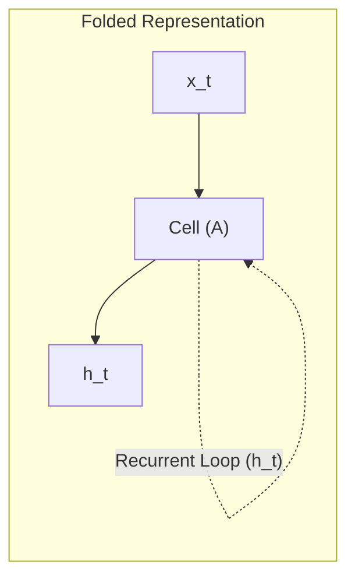
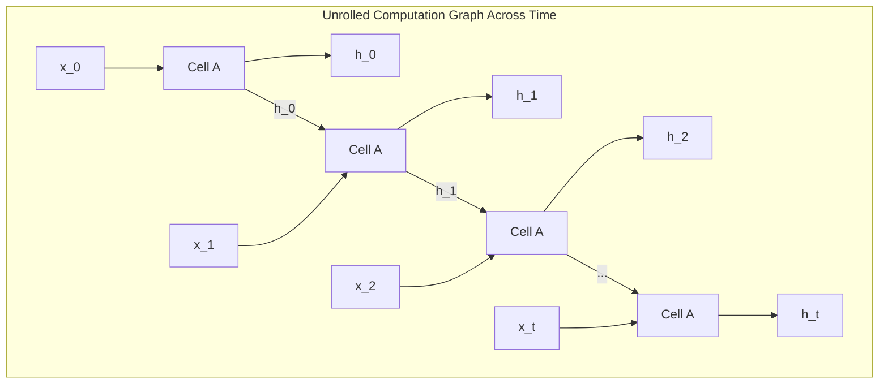
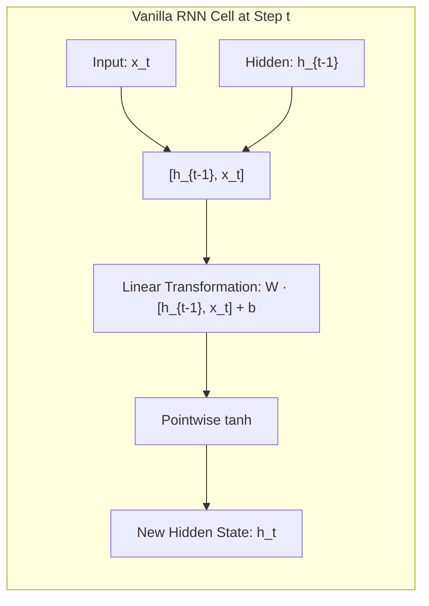
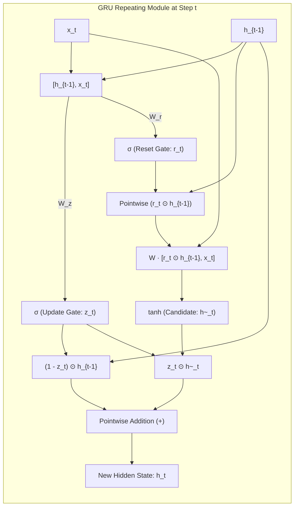

# 🧠 Colah's Guide to RNNs, LSTMs, and GRUs: Comprehensive Interview & Examination Notes

> **Based on Christopher Olah's Seminal Work**: *"Understanding LSTM Networks"* (August 27, 2015)  
> **Source Reference**: [colah.github.io/posts/2015-08-Understanding-LSTMs/](https://colah.github.io/posts/2015-08-Understanding-LSTMs/)  
> **Target Audience**: AI/ML Engineers, Data Scientists, Deep Learning Researchers preparing for technical interviews and university/competitive examinations.

---

## 📑 Table of Contents
1. [Core Intuition & The Need for Recurrence](#1-core-intuition--the-need-for-recurrence)
2. [Standard Recurrent Neural Networks (SimpleRNN)](#2-standard-recurrent-neural-networks-simplernn)
3. [The Long-Term Dependency Dilemma (The Vanishing Gradient Problem)](#3-the-long-term-dependency-dilemma-the-vanishing-gradient-problem)
4. [Colah's Mental Model of LSTM: The Conveyor Belt & Gates](#4-colahs-mental-model-of-lstm-the-conveyor-belt--gates)
5. [Step-by-Step Anatomy of an LSTM Cell](#5-step-by-step-anatomy-of-an-lstm-cell)
6. [Prominent LSTM Variants Covered by Colah](#6-prominent-lstm-variants-covered-by-colah)
7. [The Gated Recurrent Unit (GRU)](#7-the-gated-recurrent-unit-gru)
8. [Comprehensive Architectural Comparison Table](#8-comprehensive-architectural-comparison-table)
9. [Mathematical Rigor & Exact Parameter Counting (Exam Special)](#9-mathematical-rigor--exact-parameter-counting-exam-special)
10. [Top 15 Technical Interview Questions & High-Scoring Answers](#10-top-15-technical-interview-questions--high-scoring-answers)
11. [Quick-Revision Formula Cheat Sheet](#11-quick-revision-formula-cheat-sheet)

---

## 1. Core Intuition & The Need for Recurrence

### 1.1 Thinking with Persistence
Traditional feed-forward neural networks (e.g., Multilayer Perceptrons, Standard CNNs) suffer from a fundamental cognitive limitation: **they possess no temporal memory**. They treat each input sample $\mathbf{x}^{(i)}$ as completely independent of $\mathbf{x}^{(i-1)}$ and $\mathbf{x}^{(i+1)}$ ($P(\mathbf{x}_t | \mathbf{x}_{t-1}) = P(\mathbf{x}_t)$).

As Christopher Olah points out:
> *"Humans don’t start their thinking from scratch every second. As you read this essay, you understand each word based on your understanding of previous words. You don’t throw everything away and start thinking from scratch again. Your thoughts have persistence."*

If you are classifying frames in a movie, an event at frame $t$ (e.g., someone falling into water) is directly contextualized by frame $t-1$ (someone jumping off a diving board). Feed-forward networks cannot capture this without artificially flattening huge sliding windows, which leads to dimensional explosion and loss of temporal order.

### 1.2 Loops and Unrolling
Recurrent Neural Networks (RNNs) solve this by introducing **directed cycles (loops)** in their computational graphs. A recurrent module $A$ receives input $\mathbf{x}_t$ and outputs hidden state $\mathbf{h}_t$, while simultaneously passing $\mathbf{h}_t$ to itself at time $t+1$:



When unrolled across time steps $t=0, 1, \dots, T$, the network forms a continuous chain:



**Key Takeaway for Exams**: An unrolled RNN is mathematically identical to a very deep feed-forward neural network where **weights are tied (shared) across every single temporal layer**.

---

## 2. Standard Recurrent Neural Networks (SimpleRNN)

### 2.1 Cell Architecture
In a standard Vanilla RNN, the repeating module contains an elementary internal structure consisting of a single activation layer (traditionally hyperbolic tangent, $\tanh$):



### 2.2 Forward Equations
$$\mathbf{a}_t = \mathbf{W}_{hh} \mathbf{h}_{t-1} + \mathbf{W}_{xh} \mathbf{x}_t + \mathbf{b}_h$$
$$\mathbf{h}_t = \tanh(\mathbf{a}_t)$$
$$\hat{\mathbf{y}}_t = \text{softmax}(\mathbf{W}_{hy} \mathbf{h}_t + \mathbf{b}_y)$$

Or in concatenated form as presented in Colah's blog:
$$\mathbf{h}_t = \tanh(\mathbf{W} \cdot [\mathbf{h}_{t-1}, \mathbf{x}_t] + \mathbf{b})$$

Where:
- $\mathbf{x}_t \in \mathbb{R}^d$ (Input vector of dimension $d$)
- $\mathbf{h}_t \in \mathbb{R}^h$ (Hidden state vector of dimension $h$)
- $\mathbf{W} = [\mathbf{W}_{hh} \mid \mathbf{W}_{xh}] \in \mathbb{R}^{h \times (h + d)}$
- $\mathbf{b} \in \mathbb{R}^h$

---

## 3. The Long-Term Dependency Dilemma (The Vanishing Gradient Problem)

### 3.1 Short vs. Long Gap Dependencies
Olah illustrates the dependency problem through two linguistic contexts:

1. **Short Gap (Trivial for RNN)**:
   > *"The clouds are in the $\underline{\text{sky}}$."*  
   The immediately preceding words (*"clouds are in the"*) provide sufficient local syntactic context to predict *"sky"*. The temporal distance $\Delta t \approx 1-3$. SimpleRNN succeeds here.

2. **Long Gap (Failure of RNN)**:
   > *"I grew up in France... [30 intervening sentences describing childhood, school, and cuisine]... I speak fluent $\underline{\text{French}}$."*  
   Predicting *"French"* requires retaining the token *"France"* across hundreds of intermediate steps. In theory, an RNN *can* retain this information. In practice, gradient-based learning algorithms fail completely.

### 3.2 The Mathematical Root: Backpropagation Through Time (BPTT)
Let the total loss across sequence length $T$ be $L = \sum_{t=1}^T L_t$. To compute the gradient of loss $L_T$ with respect to recurrent weight matrix $\mathbf{W}_{hh}$:

$$\frac{\partial L_T}{\partial \mathbf{W}_{hh}} = \sum_{t=1}^T \frac{\partial L_T}{\partial \mathbf{h}_T} \frac{\partial \mathbf{h}_T}{\partial \mathbf{h}_t} \frac{\partial \mathbf{h}_t}{\partial \mathbf{W}_{hh}}$$

The temporal gradient flow hinges on the Jacobian chain product:
$$\frac{\partial \mathbf{h}_T}{\partial \mathbf{h}_t} = \prod_{k=t+1}^T \frac{\partial \mathbf{h}_k}{\partial \mathbf{h}_{k-1}} = \prod_{k=t+1}^T \text{diag}\left(1 - \tanh^2(\mathbf{a}_k)\right) \mathbf{W}_{hh}^T$$

### 3.3 Theoretical Consequences (Hochreiter 1991, Bengio et al. 1994)
1. **Vanishing Gradient**:  
   The derivative of $\tanh(z)$ is $\in (0, 1]$, reaching its maximum value of $1.0$ only at $z=0$. If the largest eigenvalue $\lambda_{\max}$ of $\mathbf{W}_{hh}$ satisfies $|\lambda_{\max}| < 1$, then as $(T - t) \to \infty$:
   $$\left\| \frac{\partial \mathbf{h}_T}{\partial \mathbf{h}_t} \right\| \to 0 \quad \text{exponentially rapidly}$$
   The error signal decays to zero before reaching time step $t$. The early layers receive zero weight updates and cannot learn long-term associations.

2. **Exploding Gradient**:  
   If $|\lambda_{\max}| > 1$, the product grows exponentially ($\to \infty$), causing numeric overflow (`NaN`), parameter oscillation, and training destabilization. (Solved in practice by **Gradient Clipping**: $\mathbf{g} \leftarrow \min\left(1, \frac{\text{threshold}}{\|\mathbf{g}\|}\right) \mathbf{g}$).

---

## 4. Colah's Mental Model of LSTM: The Conveyor Belt & Gates

Long Short-Term Memory networks (Hochreiter & Schmidhuber, 1997) resolve this by explicitly designing an architecture where **remembering information over long periods is the default behavior**.

### 4.1 The Core Metaphor: The Cell State as a Conveyor Belt
In Colah's words:
> *"The key to LSTMs is the cell state, the horizontal line running through the top of the diagram. The cell state is kind of like a conveyor belt. It runs straight down the entire chain, with only some minor linear interactions. It’s very easy for information to just flow along it unchanged."*

```
Cell State (C_{t-1})  ============== [* f_t] =================== [+ (i_t * \tilde{C}_t)] =============> Cell State (C_t)
                             (Forget Gate)                   (Input Gate Addition)
```

Because the cell state interactions are purely **element-wise multiplicative scaling ($f_t$) and additive updates ($+$)**, gradients can backpropagate across hundreds of time steps through the **Constant Error Carousel (CEC)** without exponential decay.

### 4.2 What Exactly is a Gate?
A gate is a structural mechanism that optionally permits information to pass through. It is formed by:
1. A **Sigmoid Neural Network Layer** ($\sigma(z) = \frac{1}{1 + e^{-z}}$), outputting scalars strictly bounded between $0$ and $1$.
   - **$0$**: *"Let nothing through"* (completely purge/block).
   - **$1$**: *"Let everything through"* (completely preserve/pass).
2. A **Pointwise Multiplication Operation ($\odot$)** that scales the incoming tensor coordinate-by-coordinate.

An LSTM contains **three distinct gates** to protect, regulate, and control the cell state:
- **Forget Gate ($f_t$)**
- **Input Gate ($i_t$)**
- **Output Gate ($o_t$)**

---

## 5. Step-by-Step Anatomy of an LSTM Cell

```mermaid
flowchart TD
    subgraph LSTMCell ["Complete LSTM Repeating Module at Step t"]
        direction TB
        Xt["x_t"] & HtPrev["h_{t-1}"] --> Concat["[h_{t-1}, x_t]"]
        
        %% Gates
        Concat -->|"W_f"| ForgetGate["σ (Forget Gate: f_t)"]
        Concat -->|"W_i"| InputGate["σ (Input Gate: i_t)"]
        Concat -->|"W_c"| CandGate["tanh (Candidate: C~_t)"]
        Concat -->|"W_o"| OutputGate["σ (Output Gate: o_t)"]
        
        %% Cell State Updates
        CtPrev["C_{t-1}"] --> MulOld["Pointwise (C_{t-1} ⊙ f_t)"]
        ForgetGate --> MulOld
        
        InputGate & CandGate --> MulNew["Pointwise (i_t ⊙ C~_t)"]
        
        MulOld & MulNew --> AddState["Pointwise Addition (+)"]
        AddState --> CtOut["New Cell State: C_t"]
        
        %% Hidden State Output
        CtOut --> TanhState["Pointwise tanh(C_t)"]
        TanhState & OutputGate --> MulOut["Pointwise (o_t ⊙ tanh(C_t))"]
        MulOut --> HtOut["New Hidden State: h_t"]
    end
```



---

### Step 1: Forget Gate Layer ($f_t$) — Deciding What to Discard
The first step inspects the previous hidden state $\mathbf{h}_{t-1}$ and the current input $\mathbf{x}_t$, generating a decision vector $\mathbf{f}_t \in [0, 1]^h$ for each scalar in the old cell state $\mathbf{C}_{t-1}$.

$$\mathbf{f}_t = \sigma(\mathbf{W}_f \cdot [\mathbf{h}_{t-1}, \mathbf{x}_t] + \mathbf{b}_f)$$

- **Colah's Language Modeling Intuition**:
  > *"In a language model trying to predict the next word, the cell state might include the gender of the present subject (e.g., 'he' vs 'she') so that correct pronouns can be chosen. When we observe a new subject noun (e.g., 'The teacher...'), we want to forget the gender of the old subject."*

---

### Step 2: Input Gate Layer ($i_t$) & Candidate State ($\tilde{\mathbf{C}}_t$) — Deciding What to Store
This step determines what new information will be registered in the cell state. It is split into two complementary operations:
1. **The Input Gate ($\mathbf{i}_t$)**: A sigmoid layer that decides *which coordinates* of the state vector should be updated.
2. **The Candidate Cell State ($\tilde{\mathbf{C}}_t$)**: A $\tanh$ layer that synthesizes a vector of new candidate values $\in [-1, 1]$ that could be incorporated into the state.

$$\mathbf{i}_t = \sigma(\mathbf{W}_i \cdot [\mathbf{h}_{t-1}, \mathbf{x}_t] + \mathbf{b}_i)$$
$$\tilde{\mathbf{C}}_t = \tanh(\mathbf{W}_c \cdot [\mathbf{h}_{t-1}, \mathbf{x}_t] + \mathbf{b}_c)$$

- **Colah's Language Modeling Intuition**:
  > *"We want to add the gender of the newly observed subject to the cell state, replacing the obsolete gender information we decided to discard in Step 1."*

---

### Step 3: State Transformation ($C_{t-1} \to C_t$) — Updating the Conveyor Belt
Now the cell state is actually modified. The old cell state $\mathbf{C}_{t-1}$ is multiplied coordinate-wise by $\mathbf{f}_t$ (discarding what we chose to forget), and then added to $\mathbf{i}_t \odot \tilde{\mathbf{C}}_t$ (incorporating our scaled candidates):

$$\mathbf{C}_t = \mathbf{f}_t \odot \mathbf{C}_{t-1} + \mathbf{i}_t \odot \tilde{\mathbf{C}}_t$$

#### 🌟 Critical Interview Question: Why Does This Equation Prevent Gradient Vanishing?
Examine the partial derivative of $\mathbf{C}_t$ with respect to $\mathbf{C}_{t-1}$:
$$\frac{\partial \mathbf{C}_t}{\partial \mathbf{C}_{t-1}} = \mathbf{f}_t$$
In contrast to standard RNN where the gradient is scaled by $\tanh'(\cdot) \mathbf{W}_{hh}$ (which shrinks exponentially), in an LSTM the error signal flows directly through $\mathbf{f}_t$. If the network learns to keep $\mathbf{f}_t \approx 1.0$, **the gradient propagates backward across arbitrary temporal spans with zero attenuation**!

---

### Step 4: Output Gate Layer ($o_t$) & Hidden State ($h_t$) — Deciding What to Emit
Finally, the model emits an output hidden state $\mathbf{h}_t$. This output is a **filtered version of the cell state**:
1. The **Output Gate ($\mathbf{o}_t$)** executes a sigmoid function over $[\mathbf{h}_{t-1}, \mathbf{x}_t]$ to decide *which coordinates* of $\mathbf{C}_t$ will be exposed.
2. The cell state $\mathbf{C}_t$ is pushed through a $\tanh$ non-linearity (normalizing values to $[-1, 1]$) and multiplied coordinate-wise by $\mathbf{o}_t$:

$$\mathbf{o}_t = \sigma(\mathbf{W}_o \cdot [\mathbf{h}_{t-1}, \mathbf{x}_t] + \mathbf{b}_o)$$
$$\mathbf{h}_t = \mathbf{o}_t \odot \tanh(\mathbf{C}_t)$$

- **Colah's Language Modeling Intuition**:
  > *"Since the model just encountered a subject, it might want to output information relevant to a verb, in case a verb follows next. For instance, it might output whether the subject was singular or plural so that the subsequent verb can be correctly conjugated."*

---

## 6. Prominent LSTM Variants Covered by Colah

Christopher Olah observes that almost every research publication introduces minor variations. The three most impactful variants are:

### Variant 1: Peephole Connections (Gers & Schmidhuber, 2000)
In standard LSTMs, the gates only observe $\mathbf{h}_{t-1}$ and $\mathbf{x}_t$; they are blind to the internal cell state $\mathbf{C}_{t-1}$. Peephole connections allow the gate layers to directly inspect the cell state:

$$\mathbf{f}_t = \sigma(\mathbf{W}_f \cdot [\mathbf{C}_{t-1}, \mathbf{h}_{t-1}, \mathbf{x}_t] + \mathbf{b}_f)$$
$$\mathbf{i}_t = \sigma(\mathbf{W}_i \cdot [\mathbf{C}_{t-1}, \mathbf{h}_{t-1}, \mathbf{x}_t] + \mathbf{b}_i)$$
$$\mathbf{o}_t = \sigma(\mathbf{W}_o \cdot [\mathbf{C}_t, \mathbf{h}_{t-1}, \mathbf{x}_t] + \mathbf{b}_o)$$

*(Note: In the output gate, $\mathbf{o}_t$ inspects the updated state $\mathbf{C}_t$.)*

### Variant 2: Coupled Forget and Input Gates
Instead of separately deciding what to forget ($\mathbf{f}_t$) and what to input ($\mathbf{i}_t$), this variant couples both decisions into a single complementary choice:
$$\mathbf{i}_t = 1 - \mathbf{f}_t$$
$$\mathbf{C}_t = \mathbf{f}_t \odot \mathbf{C}_{t-1} + (1 - \mathbf{f}_t) \odot \tilde{\mathbf{C}}_t$$

- **Intuition**: We only purge an old memory when we have a new memory ready to replace it. We only input new values when older information is vacated.

### Variant 3: Empirical Studies on LSTM Variants
- **Greff et al. (2015)** (*"LSTM: A Search Space Odyssey"*): Evaluated 8 LSTM variants on speech recognition, handwriting recognition, and polyphonic music modeling.  
  * **Finding**: The standard Vanilla LSTM performs robustly across tasks. None of the variants offer a statistically significant improvement over the baseline. The **forget gate** and the **output activation function** were identified as the two most critical components.
- **Jozefowicz et al. (2015)**: Explored over 10,000 RNN architectures.  
  * **Finding**: Initializing the forget gate bias $\mathbf{b}_f$ to a high positive value (e.g., $+1.0$ or $+2.0$) substantially improves performance on long-horizon tasks, making standard LSTMs competitive with virtually any customized architecture.

---

## 7. The Gated Recurrent Unit (GRU)

Introduced by Kyunghyun Cho et al. (2014), the **Gated Recurrent Unit (GRU)** is a streamlined, computationally efficient variant that has become extraordinarily popular.



### 7.1 Key Structural Distinctions from LSTM
1. **Merged Cell and Hidden States**: There is no separate conveyor belt $\mathbf{C}_t$. The hidden state $\mathbf{h}_t$ serves as both memory storage and network output.
2. **Coupled Forget & Input into an Update Gate ($z_t$)**: A single gate determines how much of the past state to retain versus how much of the candidate state to adopt.
3. **Reset Gate ($r_t$)**: Controls how much of the past hidden state $\mathbf{h}_{t-1}$ is presented to the candidate activation calculation.

### 7.2 Mathematical Equations
$$\mathbf{z}_t = \sigma(\mathbf{W}_z \cdot [\mathbf{h}_{t-1}, \mathbf{x}_t] + \mathbf{b}_z) \quad \text{(Update Gate)}$$
$$\mathbf{r}_t = \sigma(\mathbf{W}_r \cdot [\mathbf{h}_{t-1}, \mathbf{x}_t] + \mathbf{b}_r) \quad \text{(Reset Gate)}$$
$$\tilde{\mathbf{h}}_t = \tanh(\mathbf{W} \cdot [\mathbf{r}_t \odot \mathbf{h}_{t-1}, \mathbf{x}_t] + \mathbf{b}) \quad \text{(Candidate Hidden State)}$$
$$\mathbf{h}_t = (1 - \mathbf{z}_t) \odot \mathbf{h}_{t-1} + \mathbf{z}_t \odot \tilde{\mathbf{h}}_t \quad \text{(Final State Interpolation)}$$

*(Note: Some literature writes $\mathbf{h}_t = \mathbf{z}_t \odot \mathbf{h}_{t-1} + (1 - \mathbf{z}_t) \odot \tilde{\mathbf{h}}_t$. This is mathematically equivalent up to inversion of the update gate bias).*

---

## 8. Comprehensive Architectural Comparison Table

| Attribute | Vanilla RNN | Standard LSTM (Olah) | Gated Recurrent Unit (GRU) |
| :--- | :--- | :--- | :--- |
| **Number of Gates** | $0$ | **$3$** ($f_t, i_t, o_t$) | **$2$** ($z_t, r_t$) |
| **State Vectors** | $1$ ($\mathbf{h}_t$) | **$2$** ($\mathbf{C}_t$ Cell State, $\mathbf{h}_t$ Hidden State) | $1$ ($\mathbf{h}_t$) |
| **Internal Non-linearities** | $1$ ($\tanh$) | $4$ ($3 \times \sigma, 2 \times \tanh$) | $3$ ($2 \times \sigma, 1 \times \tanh$) |
| **Additive Memory Highway**| ❌ No (Repeated Matrix Multiplications)| ✅ **Yes ($\mathbf{C}_t = \mathbf{f} \mathbf{C}_{t-1} + \mathbf{i} \tilde{\mathbf{C}}$)** | ✅ **Yes ($\mathbf{h}_t = (1-\mathbf{z})\mathbf{h}_{t-1} + \mathbf{z}\tilde{\mathbf{h}}$)** |
| **Parameter Count Ratio** | $1\times$ | **$4\times$** | **$3\times$** |
| **Computational Speed** | Fastest | Slower | **$\approx 25-30\%$ faster than LSTM** |
| **Data Efficiency** | Prone to failure | Excels on large corpora / complex syntax | **Excels on smaller datasets** (less prone to overfitting) |
| **Vanishing Gradient** | Severe | Fully mitigated via CEC | Fully mitigated via update gate linear shortcut |

---

## 9. Mathematical Rigor & Exact Parameter Counting (Exam Special)

Examiners love asking candidates to compute the exact number of trainable parameters in an RNN, LSTM, or GRU layer given input dimension $d$ and hidden dimension $h$.

### 9.1 General Notation
- Input vector: $\mathbf{x}_t \in \mathbb{R}^d$
- Hidden state vector: $\mathbf{h}_t \in \mathbb{R}^h$
- Concatenated vector: $[\mathbf{h}_{t-1}, \mathbf{x}_t] \in \mathbb{R}^{h + d}$

---

### 9.2 SimpleRNN Parameter Formula
A single recurrent transformation:
$$\mathbf{W} \in \mathbb{R}^{h \times (h + d)}, \quad \mathbf{b} \in \mathbb{R}^h$$

$$\boxed{\text{Params}_{\text{SimpleRNN}} = h \cdot (h + d) + h = h^2 + h \cdot d + h}$$

---

### 9.3 Standard LSTM Parameter Formula
An LSTM has **4 internal linear operations** (Forget Gate, Input Gate, Candidate State, Output Gate):
- $\mathbf{W}_f \in \mathbb{R}^{h \times (h + d)}, \mathbf{b}_f \in \mathbb{R}^h$
- $\mathbf{W}_i \in \mathbb{R}^{h \times (h + d)}, \mathbf{b}_i \in \mathbb{R}^h$
- $\mathbf{W}_c \in \mathbb{R}^{h \times (h + d)}, \mathbf{b}_c \in \mathbb{R}^h$
- $\mathbf{W}_o \in \mathbb{R}^{h \times (h + d)}, \mathbf{b}_o \in \mathbb{R}^h$

$$\boxed{\text{Params}_{\text{LSTM}} = 4 \times \left[ h \cdot (h + d) + h \right] = 4 \cdot (h^2 + h \cdot d + h)}$$

*(If Peephole connections are included with diagonal peephole vectors $\mathbf{p}_f, \mathbf{p}_i, \mathbf{p}_o \in \mathbb{R}^h$, add $3h$ parameters).*

---

### 9.4 GRU Parameter Formula
A GRU has **3 internal linear operations** (Update Gate, Reset Gate, Candidate Hidden State):
- $\mathbf{W}_z \in \mathbb{R}^{h \times (h + d)}, \mathbf{b}_z \in \mathbb{R}^h$
- $\mathbf{W}_r \in \mathbb{R}^{h \times (h + d)}, \mathbf{b}_r \in \mathbb{R}^h$
- $\mathbf{W} \in \mathbb{R}^{h \times (h + d)}, \mathbf{b} \in \mathbb{R}^h$

$$\boxed{\text{Params}_{\text{GRU}} = 3 \times \left[ h \cdot (h + d) + h \right] = 3 \cdot (h^2 + h \cdot d + h)}$$

---

### 9.5 Concrete Exam Problem (Walkthrough)
**Question**: *A natural language model has an embedding layer with dimension $d = 128$. The sequence is fed into a recurrent layer with hidden dimension $h = 256$. Calculate the total trainable parameters for: (a) SimpleRNN, (b) Standard LSTM, (c) GRU.*

**Solution**:
1. Base unit:
   $$h \cdot (h + d) + h = 256 \cdot (256 + 128) + 256 = 256 \cdot 384 + 256 = 98,304 + 256 = 98,560$$
2. **SimpleRNN**:
   $$\text{Params} = 1 \times 98,560 = \mathbf{98,560}$$
3. **Standard LSTM**:
   $$\text{Params} = 4 \times 98,560 = \mathbf{394,240}$$
4. **GRU**:
   $$\text{Params} = 3 \times 98,560 = \mathbf{295,680}$$

---

## 10. Top 15 Technical Interview Questions & High-Scoring Answers

### Q1: Why do standard RNNs suffer from vanishing gradients while feed-forward networks with identical depth do not suffer as severely?
**Model Answer**:  
In feedforward networks, weight matrices at different layers are distinct ($\mathbf{W}_1, \mathbf{W}_2, \dots, \mathbf{W}_L$). Initialization techniques (He/Xavier) and residual skips keep activations stable. In an unrolled RNN, the **exact same matrix $\mathbf{W}_{hh}$ is multiplied repeatedly at every time step**. Mathematically, computing $\frac{\partial \mathbf{h}_T}{\partial \mathbf{h}_1}$ involves $\mathbf{W}_{hh}^{T-1}$. If the spectral radius of $\mathbf{W}_{hh}$ has eigenvalues $< 1$, the continuous matrix power forces gradients to decay exponentially to zero.

---

### Q2: How does the LSTM architecture solve the vanishing gradient problem mathematically?
**Model Answer**:  
The core mechanism is the **additive cell state equation** ($\mathbf{C}_t = \mathbf{f}_t \odot \mathbf{C}_{t-1} + \mathbf{i}_t \odot \tilde{\mathbf{C}}_t$). When computing the gradient of the loss at step $T$ with respect to $\mathbf{C}_t$:
$$\frac{\partial \mathbf{C}_T}{\partial \mathbf{C}_t} = \prod_{k=t+1}^T \frac{\partial \mathbf{C}_k}{\partial \mathbf{C}_{k-1}} = \prod_{k=t+1}^T \mathbf{f}_k$$
This gradient is purely additive and scaled by the forget gate activation $\mathbf{f}_k$. It does **not** involve multiplying by weight matrices $\mathbf{W}$ or passing through saturating derivatives of $\tanh$. If the forget gate is saturated at $1.0$, the gradient flows back across time completely undiminished. This channel is known as the **Constant Error Carousel (CEC)**.

---

### Q3: Why are sigmoid ($\sigma$) and hyperbolic tangent ($\tanh$) used specifically in LSTMs? Why not ReLU?
**Model Answer**:  
- **Sigmoid for Gates**: Gates represent probabilistic valves deciding what percentage of information should pass through. The range $[0, 1]$ of the sigmoid function naturally corresponds to a 0% to 100% pass-through filter.
- **$\tanh$ for States**: $\tanh$ outputs values in $[-1, 1]$, centered at zero. This allows the network to both **add** (positive values) and **subtract** (negative values) information from the cell state.
- **Why not ReLU inside the recurrent cell?**: If an unbounded function like $\text{ReLU}(z) = \max(0, z)$ were used on the recurrent state without normalization, unbounded positive values would compound over time steps ($t=100 \implies x \gg 10^{30}$), resulting in explosive numerical overflow and unbounded activation drift.

---

### Q4: Why is it recommended to initialize the forget gate bias ($b_f$) to 1.0 or 2.0?
**Model Answer**:  
At initial training time, weights are typically initialized around 0 with zero-centered Gaussian distributions. If $b_f = 0$, then $\sigma(0) = 0.5$. A forget gate of $0.5$ will attenuate the cell state by $50\%$ at every single time step ($0.5^{10} \approx 0.00097$). By setting $b_f = 1.0$ or $2.0$, $\sigma(b_f) \approx 0.73 - 0.88$, which defaults the LSTM to **remembering everything by default** at the beginning of training, replicating identity gradient flow until it learns what specific patterns to forget (Jozefowicz et al., 2015).

---

### Q5: What is the semantic difference between the Cell State ($C_t$) and Hidden State ($h_t$)?
**Model Answer**:  
- **Cell State ($C_t$)**: Internal long-term memory. It acts as an uninterrupted internal register that stores high-level context (e.g., tense of a story, open parentheses count, grammatical subject). It is never directly exposed as the network's prediction.
- **Hidden State ($h_t$)**: Filtered, task-specific working memory. It represents the immediate output of the cell at step $t$ ($\mathbf{h}_t = \mathbf{o}_t \odot \tanh(\mathbf{C}_t)$), reflecting only the context needed for immediate downstream tasks (e.g., predicting the next token or driving a classification layer).

---

### Q6: What are Peephole Connections, and what problem do they solve?
**Model Answer**:  
In standard LSTMs, the gates ($\mathbf{f}_t, \mathbf{i}_t, \mathbf{o}_t$) only observe $\mathbf{h}_{t-1}$ and $\mathbf{x}_t$. If the output gate $\mathbf{o}_{t-1}$ was closed ($0$), $\mathbf{h}_{t-1}$ becomes near-zero, leaving the subsequent gates blind to what is currently held inside $\mathbf{C}_{t-1}$. **Peephole connections** (Gers & Schmidhuber, 2000) add direct feed-forward links from $\mathbf{C}_{t-1}$ into the gate activations. This enables the model to inspect internal memory contents when deciding whether to trigger a gate, which is especially useful for tasks requiring precise interval timing and counting.

---

### Q7: Compare LSTM vs. GRU. When would you select one over the other?
**Model Answer**:  
- **Computational Footprint**: GRU has $25\%$ fewer parameters than LSTM ($3 \times$ vs $4 \times$ base units), trains noticeably faster, and consumes less GPU VRAM.
- **Dataset Size**: When training data is limited, GRU's smaller parameterization reduces the risk of overfitting.
- **Complexity & Long Context**: For massive datasets requiring long-range modeling of hierarchical syntax or long sequences, LSTMs often demonstrate superior expressive capacity due to the independent regulation offered by decoupled cell and hidden states.

---

### Q8: What is Gradient Clipping, and why is it essential for training RNNs?
**Model Answer**:  
While LSTMs and GRUs resolve vanishing gradients, they remain susceptible to **exploding gradients** when deep in time ($|\lambda| > 1$). Gradient clipping caps the gradient norm before optimizer application:
$$\mathbf{g} \leftarrow \begin{cases} \mathbf{g} & \text{if } \|\mathbf{g}\| \le \tau \\ \tau \frac{\mathbf{g}}{\|\mathbf{g}\|} & \text{if } \|\mathbf{g}\| > \tau \end{cases}$$
This preserves the true gradient *direction* in parameter space while strictly bounding the step size, preventing destructive updates that derail training.

---

### Q9: Can an LSTM process sequences in parallel during training like a Transformer?
**Model Answer**:  
**No.** An LSTM cell requires $\mathbf{h}_{t-1}$ and $\mathbf{C}_{t-1}$ to compute $\mathbf{h}_t$ and $\mathbf{C}_t$. This creates an unbreakable **sequential temporal dependency** ($O(T)$ sequential steps). Even on massively parallel hardware (GPUs), the forward and backward passes must step through time step-by-step. Transformers eliminate recurrent cycles in favor of self-attention ($\mathbf{Q}\mathbf{K}^T$), allowing full parallelization across the sequence length during training.

---

### Q10: What is Teacher Forcing, and what is its associated risk (Exposure Bias)?
**Model Answer**:  
- **Teacher Forcing**: A training technique for autoregressive sequence models where the ground-truth target token $\mathbf{y}_{t-1}^*$ is fed as input $\mathbf{x}_t$ at step $t$, rather than the model's own predicted token $\hat{\mathbf{y}}_{t-1}$. This stabilizes and accelerates early training.
- **Exposure Bias**: At test/inference time, ground-truth tokens are unavailable, so the model must feed its own predictions back into itself. If the model makes a small error early on, it encounters an input distribution it was never exposed to during teacher-forced training, leading to compounding errors down the sequence.

---

### Q11: How does a Bidirectional LSTM (BiLSTM) work? Can it be used for autoregressive text generation?
**Model Answer**:  
A BiLSTM runs two independent recurrent passes simultaneously: a forward pass ($\overrightarrow{\mathbf{h}}_t$) processing tokens from $t=1 \to T$, and a backward pass ($\overleftarrow{\mathbf{h}}_t$) processing from $t=T \to 1$. The concatenated hidden state $\mathbf{h}_t = [\overrightarrow{\mathbf{h}}_t \parallel \overleftarrow{\mathbf{h}}_t]$ contains complete contextual awareness of both past and future tokens.  
**Autoregressive Text Generation**: **No**, it cannot be used for causal autoregressive next-word prediction because generating word $t+1$ requires knowing tokens at $t+2, t+3, \dots, T$, which do not exist yet. BiLSTMs are strictly used for sequence classification, named entity recognition (NER), and feature extraction.

---

### Q12: What is Truncated Backpropagation Through Time (TBPTT)?
**Model Answer**:  
When sequence lengths are extremely long (e.g., 50,000 audio samples or entire novels), running full BPTT across all $T$ steps is computationally infeasible and exceeds GPU memory. **Truncated BPTT** splits sequences into manageable sub-chunks of length $k_1$. Forward pass runs through $k_1$ steps, hidden state is passed along to the next chunk, but backward pass gradients are backpropagated only for $k_2$ steps ($k_2 \le k_1$) before truncating the graph.

---

### Q13: If an LSTM's forget gate vector is set to all zeros ($f_t = \mathbf{0}$) and input gate to all ones ($i_t = \mathbf{1}$), what does the cell behave like?
**Model Answer**:  
If $\mathbf{f}_t = \mathbf{0}$, the term $\mathbf{f}_t \odot \mathbf{C}_{t-1}$ becomes zero; all past memory is wiped out at every step. If $\mathbf{i}_t = \mathbf{1}$, the cell state becomes strictly $\mathbf{C}_t = \tilde{\mathbf{C}}_t = \tanh(\mathbf{W}_c [\mathbf{h}_{t-1}, \mathbf{x}_t] + \mathbf{b}_c)$. The cell degenerates into a stateless feed-forward Markov model whose memory extends back only a single step ($\Delta t = 1$).

---

### Q14: Why do modern Transformers struggle with streaming/real-time edge audio compared to LSTMs/GRUs?
**Model Answer**:  
Transformers maintain an attention matrix whose memory footprint and compute scale as $O(T^2)$ with sequence length $T$. For streaming edge applications (e.g., wake-word detection, live hearing aids, microcontrollers), maintaining an ever-growing KV-cache is prohibitively memory-intensive. An LSTM/GRU has a **constant memory footprint $O(1)$ and constant time complexity $O(1)$ per time step**, making recurrent architectures ideal for memory-constrained edge hardware.

---

### Q15: In Colah's blog, what did he identify as the natural "next big step" beyond LSTMs?
**Model Answer**:  
In Section 7 of his blog post, Christopher Olah foresaw:
> *"A common opinion among researchers is: 'Yes! There is a next step and it’s attention!' The idea is to let every step of an RNN pick information to look at from some larger collection of information."*  
This prediction (written in 2015) anticipated the Bahdanau/Luong attention mechanisms, which directly paved the way for the seminal 2017 paper *"Attention Is All You Need"* and modern Transformer LLMs.

---

## 11. Quick-Revision Formula Cheat Sheet

### All 12 Foundational Equations at a Glance

| Component | Standard Form Equation | Output Range |
| :--- | :--- | :--- |
| **SimpleRNN State** | $\mathbf{h}_t = \tanh(\mathbf{W} \cdot [\mathbf{h}_{t-1}, \mathbf{x}_t] + \mathbf{b})$ | $[-1, 1]$ |
| **LSTM Forget Gate** | $\mathbf{f}_t = \sigma(\mathbf{W}_f \cdot [\mathbf{h}_{t-1}, \mathbf{x}_t] + \mathbf{b}_f)$ | $[0, 1]$ |
| **LSTM Input Gate** | $\mathbf{i}_t = \sigma(\mathbf{W}_i \cdot [\mathbf{h}_{t-1}, \mathbf{x}_t] + \mathbf{b}_i)$ | $[0, 1]$ |
| **LSTM Candidate State** | $\tilde{\mathbf{C}}_t = \tanh(\mathbf{W}_c \cdot [\mathbf{h}_{t-1}, \mathbf{x}_t] + \mathbf{b}_c)$ | $[-1, 1]$ |
| **LSTM Cell State Update** | $\mathbf{C}_t = \mathbf{f}_t \odot \mathbf{C}_{t-1} + \mathbf{i}_t \odot \tilde{\mathbf{C}}_t$ | Unbounded |
| **LSTM Output Gate** | $\mathbf{o}_t = \sigma(\mathbf{W}_o \cdot [\mathbf{h}_{t-1}, \mathbf{x}_t] + \mathbf{b}_o)$ | $[0, 1]$ |
| **LSTM Hidden Output** | $\mathbf{h}_t = \mathbf{o}_t \odot \tanh(\mathbf{C}_t)$ | $[-1, 1]$ |
| **Peephole Forget Gate** | $\mathbf{f}_t = \sigma(\mathbf{W}_f \cdot [\mathbf{C}_{t-1}, \mathbf{h}_{t-1}, \mathbf{x}_t] + \mathbf{b}_f)$ | $[0, 1]$ |
| **Coupled LSTM State** | $\mathbf{C}_t = \mathbf{f}_t \odot \mathbf{C}_{t-1} + (1 - \mathbf{f}_t) \odot \tilde{\mathbf{C}}_t$ | Unbounded |
| **GRU Update Gate** | $\mathbf{z}_t = \sigma(\mathbf{W}_z \cdot [\mathbf{h}_{t-1}, \mathbf{x}_t] + \mathbf{b}_z)$ | $[0, 1]$ |
| **GRU Reset Gate** | $\mathbf{r}_t = \sigma(\mathbf{W}_r \cdot [\mathbf{h}_{t-1}, \mathbf{x}_t] + \mathbf{b}_r)$ | $[0, 1]$ |
| **GRU State Update** | $\mathbf{h}_t = (1 - \mathbf{z}_t) \odot \mathbf{h}_{t-1} + \mathbf{z}_t \odot \tanh(\mathbf{W} [\mathbf{r}_t \odot \mathbf{h}_{t-1}, \mathbf{x}_t] + \mathbf{b})$ | $[-1, 1]$ |

---

### Red-Flag Answers in Interviews (What NOT to Say)

❌ **"LSTMs completely eliminate the vanishing gradient problem."**  
✔️ **Say**: "LSTMs create a constant-error additive path through the cell state that *substantially mitigates* the vanishing gradient problem, though gradients can still degrade over thousands of steps if forget gates remain small."

❌ **"The cell state $C_t$ passes through a sigmoid activation."**  
✔️ **Say**: "The cell state is modified via linear scaling and addition, and only passes through a $\tanh$ non-linearity when computing the filtered hidden state $\mathbf{h}_t$."

❌ **"GRU is always better than LSTM because it is newer and faster."**  
✔️ **Say**: "GRU is computationally lighter with $25\%$ fewer parameters and often matches LSTM performance on small-to-medium corpora. However, LSTMs retain superior representational capacity on large-scale, complex sequential datasets."
