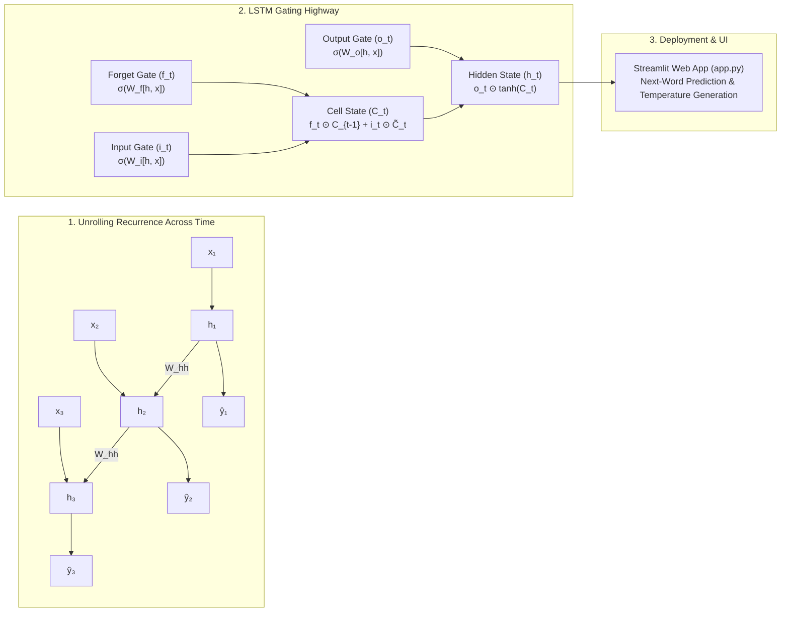

# 🔄 Deep Learning — Module 3: Recurrent Neural Networks (RNN & LSTM)

Welcome to the **Recurrent Neural Networks (RNN)** foundational module of the Deep Learning repository. This module covers sequential modeling from first principles: from simple recurrent hidden state transitions and Backpropagation Through Time (BPTT) to advanced gating mechanisms (LSTM & GRU), dense word embeddings, temperature-controlled text decoding, and an end-to-end Next-Word Prediction production application with an interactive Streamlit UI.

---

## 📁 Repository Structure

```text
4. Deep Learning/
└── 3. RNN/
    ├── README.md                                                        # Module Index & Theory Guide
    ├── Deep Learning - RNN.pdf                                          # Visual Lecture Notes (22MB)
    ├── app.py                                                           # Interactive Streamlit Web Application
    ├── data/                                                            # Centralized Datasets
    │   └── qoute_dataset.csv                                            # 3,038 Inspirational Quotes Dataset
    ├── models/                                                          # Serialized Production Artifacts
    │   ├── lstm_model.h5                                                # Trained Stacked LSTM Model (7.5MB)
    │   ├── max_len.pkl                                                  # Maximum Sequence Context Window
    │   ├── tokenizer.pkl                                                # Trained Keras Tokenizer
    │   └── vocab.json                                                   # Plain JSON Vocabulary Mapping (Universal)
    └── notebooks/                                                       # Curated Notebooks (Basics to Advanced)
        ├── 1. Basics - Sequence Modeling & Simple RNN Foundations.ipynb # 🟢 Level 1: Sequences, Transitions & BPTT
        ├── 2. Core - LSTMs, GRUs & Vanishing Gradient Solutions.ipynb   # 🟡 Level 2: Gating Mechanisms & Memory Highway
        ├── 3. Deep Dive - Bidirectional RNNs, Word Embeddings & Sampling.ipynb # 🟠 Level 3: Dense Embeddings & Temperature
        ├── 4. Advanced Project - Next-Word Prediction & Text Generation System.ipynb # 🔴 Level 4: Quotes Autoregressive Engine
        └── 5. Masterclass - Complete RNN End-to-End Curriculum.ipynb    # 🏆 Unified Complete Masterclass
```

---

## 🗺️ Visual Architecture & Sequence Processing Pipeline



---

## 🗺️ Progressive Learning Curriculum (Basics to Advanced)

### [🟢 1. Basics: Sequence Modeling & Simple RNN Foundations](file:///c:/Users/ayush/OneDrive/Desktop/TagPractice/Gen-AI-Learnings/4.%20Deep%20Learning/3.%20RNN/notebooks/1.%20Basics%20-%20Sequence%20Modeling%20%26%20Simple%20RNN%20Foundations.ipynb)
* **Why ANNs Fail on Sequential Data**:
  * Inability to handle variable-length inputs without destructive truncation or excessive zero-padding.
  * Lack of temporal parameter sharing (ANNs must relearn representations for words at position 1 vs. position 5).
  * No memory state (feedforward networks treat each token as independent and identically distributed).
* **The Recurrent Neuron**:
  * Hidden state transition formula:
    $$h_t = \tanh(W_{hh} h_{t-1} + W_{xh} x_t + b_h)$$
  * Output projection:
    $$\hat{y}_t = \text{Softmax}(W_{hy} h_t + b_y)$$
* **Backpropagation Through Time (BPTT)**:
  * Error gradient accumulation across time:
    $$\frac{\partial \mathcal{L}}{\partial W_{hh}} = \sum_{t=1}^T \sum_{k=1}^t \frac{\partial \mathcal{L}_t}{\partial h_t} \frac{\partial h_t}{\partial h_k} \frac{\partial h_k}{\partial W_{hh}}$$
* **The Vanishing & Exploding Gradient Dilemma**:
  * Product of Jacobians $\prod W_{hh}^T \text{diag}(1 - h_j^2)$ causing exponential decay toward 0.
  * Gradient clipping to prevent numerical instability ($\text{NaN}/\text{Inf}$).
* **Pure NumPy Implementation**: `SimpleRNNFromScratch` unrolling over 15 timesteps with hidden state heatmaps.

---

### [🟡 2. Core: LSTMs, GRUs & Vanishing Gradient Solutions](file:///c:/Users/ayush/OneDrive/Desktop/TagPractice/Gen-AI-Learnings/4.%20Deep%20Learning/3.%20RNN/notebooks/2.%20Core%20-%20LSTMs,%20GRUs%20%26%20Vanishing%20Gradient%20Solutions.ipynb)
* **The Short-Term Memory Bottleneck**: Why standard RNNs fail on contexts beyond 10 timesteps.
* **Long Short-Term Memory (LSTM) Architecture (Hochreiter & Schmidhuber, 1997)**:
  * **Cell State Highway ($C_t$)**: Additive linear constant error carousel preventing gradient attenuation.
  * **Forget Gate ($f_t$)**: $f_t = \sigma(W_f [h_{t-1}, x_t] + b_f)$
  * **Input Gate ($i_t$) & Candidate Memory ($\tilde{C}_t$)**: $i_t = \sigma(W_i [h_{t-1}, x_t] + b_i)$, $\tilde{C}_t = \tanh(W_c [h_{t-1}, x_t] + b_c)$
  * **Cell State Update**: $C_t = f_t \odot C_{t-1} + i_t \odot \tilde{C}_t$
  * **Output Gate ($o_t$) & Hidden State ($h_t$)**: $o_t = \sigma(W_o [h_{t-1}, x_t] + b_o)$, $h_t = o_t \odot \tanh(C_t)$
* **Gated Recurrent Unit (GRU) (Cho et al., 2014)**:
  * Merged hidden state with Reset ($r_t$) and Update ($z_t$) gates.
  * 25% parameter reduction over LSTM with comparable performance.
* **Empirical Memory Retention Shootout**: Comparing SimpleRNN, GRU, and LSTM on retaining information across 30 noise steps.

---

### [🟠 3. Deep Dive: Bidirectional RNNs, Word Embeddings & Sampling](file:///c:/Users/ayush/OneDrive/Desktop/TagPractice/Gen-AI-Learnings/4.%20Deep%20Learning/3.%20RNN/notebooks/3.%20Deep%20Dive%20-%20Bidirectional%20RNNs,%20Word%20Embeddings%20%26%20Sampling.ipynb)
* **Word Representations**:
  * Sparse orthogonal one-hot vectors vs. Dense continuous word embeddings ($\mathbb{R}^{|V|} \to \mathbb{R}^D$).
  * Embedding lookup matrix mechanics ($E \in \mathbb{R}^{V \times D}$).
* **Bidirectional Recurrent Architectures**:
  * Forward pass ($\overrightarrow{h}_t$) + Backward pass ($\overleftarrow{h}_t$).
  * When to use Bidirectional (Classification, NER) vs. When NOT to use (Autoregressive generation).
* **Text Decoding & Sampling Strategies**:
  * **Greedy Search ($\arg\max$)**: Deterministic, susceptible to repetitive loops.
  * **Temperature-Scaled Softmax**:
    $$P(w_i) = \frac{\exp(z_i / T)}{\sum_j \exp(z_j / T)}$$
    * $T < 0.5$: Safe, conservative, repetitive.
    * $T \approx 0.7 - 0.8$: Optimal balance of coherence and diversity.
    * $T > 1.2$: High entropy, creative, exploratory.
  * **Top-K & Top-P (Nucleus) Sampling**.
* **Perplexity (PPL)**: The standard intrinsic evaluation metric for language modeling.

---

### [🔴 4. Advanced Project: Next-Word Prediction & Text Generation System](file:///c:/Users/ayush/OneDrive/Desktop/TagPractice/Gen-AI-Learnings/4.%20Deep%20Learning/3.%20RNN/notebooks/4.%20Advanced%20Project%20-%20Next-Word%20Prediction%20%26%20Text%20Generation%20System.ipynb)
* **Production Problem**: Predictive keyboard assistance, query auto-completion, and literary quote synthesis.
* **Data Preprocessing**:
  * Ingesting `../data/qoute_dataset.csv` (3,038 inspirational quotes).
  * Lowercasing, punctuation stripping, vocabulary mapping.
  * N-Gram sequence expansion and uniform pre-padding.
* **Production LSTM Architecture**:
  $$\text{Input}(L) \to \text{Embedding}(V, 50) \to \text{LSTM}(128, \text{ReturnSeq}) \to \text{Dropout}(0.2) \to \text{LSTM}(64) \to \text{Dense}(64) \to \text{Dense}(V, \text{Softmax})$$
* **Multi-Word Quote Generator Engine**: Autoregressive sequence generation with temperature-controlled sampling.
* **Production Inference API**: Function returning top candidate suggestions with probability confidence bars.

---

### [🏆 5. Masterclass: Complete RNN End-to-End Curriculum](file:///c:/Users/ayush/OneDrive/Desktop/TagPractice/Gen-AI-Learnings/4.%20Deep%20Learning/3.%20RNN/notebooks/5.%20Masterclass%20-%20Complete%20RNN%20End-to-End%20Curriculum.ipynb)
* The complete, unified reference combining all four progressive modules into a single, cohesive, publication-quality interactive notebook.

---

## 🚀 Running the Streamlit Web Application

To launch the interactive Next-Word Prediction and Quote Generation interface:

```bash
cd "4. Deep Learning/3. RNN"
streamlit run app.py
```

### Application Features:
1. **Single Next-Word Predictor**: Type any sentence to get immediate next-word suggestions with interactive confidence distribution bar charts.
2. **Creative Quote Generator**: Choose your prompt seed, set desired quote length (5-25 words), and tune creativity using the **Temperature Slider** ($0.1$ to $1.5$).
3. **Interactive Theory & Architecture Guide**: In-app mathematical references and architectural documentation.

---

## ⚡ Mathematical Formulas Cheat Sheet

### 1. SimpleRNN Hidden State Transition
$$h_t = \tanh(W_{hh} h_{t-1} + W_{xh} x_t + b_h)$$

### 2. LSTM Gating Equations
* **Forget Gate**: $f_t = \sigma(W_f [h_{t-1}, x_t] + b_f)$
* **Input Gate**: $i_t = \sigma(W_i [h_{t-1}, x_t] + b_i)$
* **Candidate State**: $\tilde{C}_t = \tanh(W_c [h_{t-1}, x_t] + b_c)$
* **Cell State Update**: $C_t = f_t \odot C_{t-1} + i_t \odot \tilde{C}_t$
* **Output Gate**: $o_t = \sigma(W_o [h_{t-1}, x_t] + b_o)$
* **Hidden State**: $h_t = o_t \odot \tanh(C_t)$

### 3. GRU Equations
* **Reset Gate**: $r_t = \sigma(W_r [h_{t-1}, x_t] + b_r)$
* **Update Gate**: $z_t = \sigma(W_z [h_{t-1}, x_t] + b_z)$
* **Candidate State**: $\tilde{h}_t = \tanh(W [r_t \odot h_{t-1}, x_t] + b)$
* **Hidden State**: $h_t = (1 - z_t) \odot h_{t-1} + z_t \odot \tilde{h}_t$

### 4. Temperature-Scaled Softmax
$$P(w_i) = \frac{\exp(z_i / T)}{\sum_{j=1}^{|V|} \exp(z_j / T)}$$

### 5. Perplexity (Language Model Metric)
$$\text{PPL} = \exp\left( -\frac{1}{N} \sum_{i=1}^N \ln P(w_i \mid w_1, \dots, w_{i-1}) \right)$$
